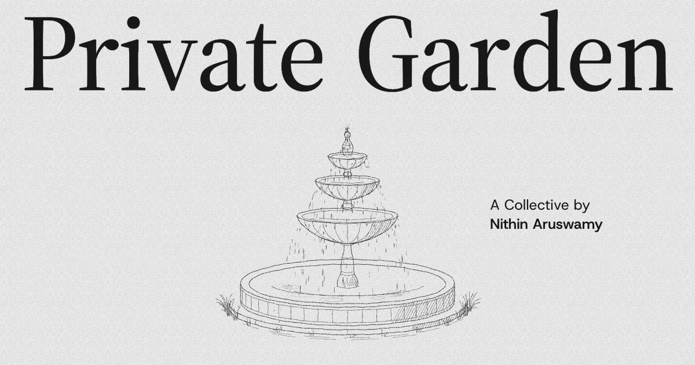

<p align="center">
  <a href="https://studio.nithinaruswamy.com">
    
  </a>
</p>

<p align="center"><em>A design collective by Nithin Aruswamy</em></p>

<p align="center"><a href="https://studio.nithinaruswamy.com"><code>studio.nithinaruswamy.com</code></a></p>

<br>

<p align="center">
  
  
  
  
  
</p>

<p align="center"><sub>WHAT I KEEP RETURNING TO</sub></p>

<br>

<p align="center"><code>film</code> → <code>photos</code> → <code>ruler</code> → <code>title</code> → <code>fountain</code></p>

<br>

---

<p align="center"><sub>Plain HTML, CSS and JavaScript. No build step.</sub></p>

```
python3 -m http.server 4173
```

<p align="center"><sub>Everything you'd swap lives in <code>config.js</code>.</sub></p>
